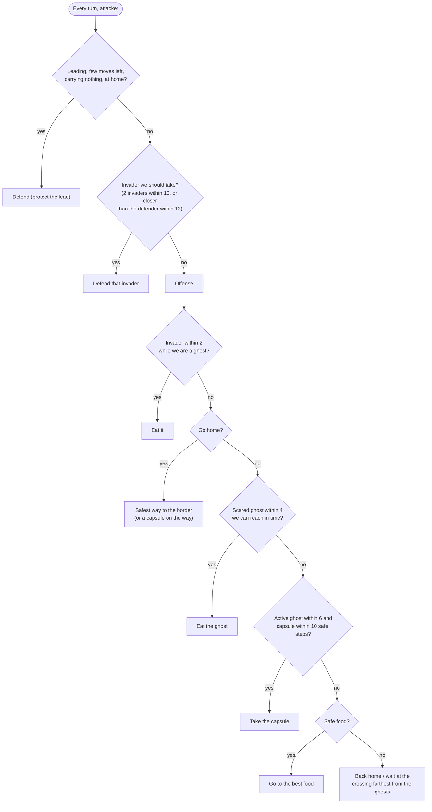
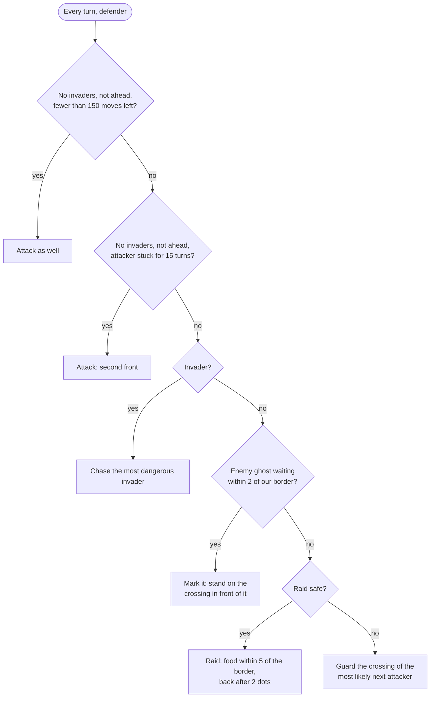

# Strategy and architecture

This document describes the agent in [`my_team.py`](my_team.py): two `FlexAgent`s that
share one `TeamBrain`. One agent attacks and one defends, but both roles can switch
behaviour with the score, the time left and what the opponents are doing.

The agent is built on four ideas:

1. **Opponent tracking**: a position belief for every opponent, updated from sonar
   readings, visibility, eaten food and the opponent's side of the board.
2. **Time-aware safe search**: a cell is used only if we reach it before any dangerous
   ghost can, and a dead-end corridor is entered only if we can leave it in time.
3. **Priority rules per role**: a short, ordered list of situations for the attacker
   and for the defender, each with its own behaviour.
4. **Stable decisions**: memory and stickiness so that enemies flickering in and out
   of sight, or stepping in and out at the border, do not make our agents oscillate.

---

## 1. Shared team brain

`TeamBrain` is created once per team in `create_team` and set up by the first agent in
`register_initial_state` (the second one reuses it, including the maze distances).

**Precomputed once per game**

| Data | Use |
|---|---|
| All-pairs maze distances (`Distancer`), read straight from its table | every distance in the code |
| `home_border`: our border cells that touch an enemy cell | crossing points, the way home |
| `dist_home[c]`: distance from every cell to the nearest home border cell | carry limit, way home, raids |
| `trap_exit[c]`, `trap_depth[c]`: dead-end corridors (see §3) | safe food selection |
| Roles: the agent whose start is closer to the enemy food attacks | `brain.roles` |

**Opponent beliefs** (`update_beliefs`, run before every move)

Each opponent has a belief, a dictionary *cell → probability*.

- **Seen** (within 5 Manhattan of either of our agents): the belief collapses to its
  exact cell.
- **Time step**: only the opponent that played just before us has moved, so only its
  belief spreads to the neighbouring cells.
- **Observation**: a cell stays possible only if
  - it is on the side the opponent is on (`is_pacman` is readable even when the enemy is
    not seen),
  - it is more than 5 Manhattan from both our agents (otherwise we would see it),
  - its Manhattan distance agrees with the noisy sonar reading (noise is at most ±6).
- **Eaten food**: a food dot or capsule that disappears from our side pinpoints the
  invader that just moved.
- **Eaten enemy**: an enemy that vanishes next to one of our agents, or whose food
  reappears on the board, is reset to its start cell.
- If no cell survives, the belief is rebuilt (start cell first, then every cell that
  fits the observation).

`estimate(opp)` returns the most likely cell.

---

## 2. Attacker

**When to go home** (only while carrying food):

- the game can be finished (`food ≤ 2` or we carry everything still needed), or
- time is almost up (`moves left ≤ distance home + 3`), or
- an active ghost is within 6 and we carry at least 2, or
- we carry at least the **carry limit**:
  `CARRY_BASE + dist_home // 6`, minus 1 when we lead by more than 5, at most 3 when
  6 or fewer dots are left, never below 2.

**Food choice** (`pick_food`): among the food reachable by the safe search, minimise

`steps to reach it + 0.25 · carrying · dist_home / 3 − 2 (if it is the current target)`.

Capsules are candidates too: −4 when a visible ghost is hunting us, +6 otherwise.
When the defender attacks as well, it adds +6 to food within 3 of the attacker's
target, so the two agents spread out.
A food dot inside a dead end is skipped unless we can leave the corridor in time.

**Risk levels** (`risk_level`): when the attacker has been at the border for a long
time without eating and we are not ahead, it accepts more risk:

| Level | Trigger | Plans around |
|---|---|---|
| 0 | default | visible ghosts + estimated positions of unseen ghosts |
| 1 | blocked > `RISK1` (10) turns | visible ghosts + ghosts seen in the last 5 rounds |
| 2 | blocked > `RISK2` (30) turns | the same ghosts, but only within distance 2 |

The counter resets whenever our score goes up.

---

## 3. Safe search and dead ends

All movement uses breadth-first search from our cell (`bfs`), with a predicate that
says whether a cell can be entered after `t` steps (`danger_fn`):

- cells on our half are always allowed (we are a ghost there);
- an enemy cell is forbidden if a dangerous ghost is at maze distance `≤ t` from it;
- a scared ghost is ignored while its timer is larger than `t + 1`.

So a cell is used only if we get there before any ghost can. When there is no safe
way home, the margin is relaxed by one and then two steps, and as a last resort the
attacker moves away from the closest ghost (`evade`).

**Dead ends** (`_compute_dead_ends`): cells with a single open neighbour are removed
repeatedly. Every removed cell lies in a dead-end corridor. A BFS from the remaining
cells gives each one its exit junction `J` and its depth `d`. A dead-end target reached
after `t` steps is allowed only if no dangerous ghost can reach `J` within `t + d + 1`
steps (`escape_ok`).

---

## 4. Defender

- **Target**: the invader minimising `distance − 3 (if visible) − food carried`.
- **Chase**: shortest path that never leaves our half. When the attacker chases the
  same invader and is closer, the defender cuts off the escape instead
  (`block_cell`): a cell on the invader's way home if it carries food, otherwise the
  cell of the invader's region farthest from the partner.
- **Scared defender**: keep exactly 2 cells from the invader (`shadow`), ready to eat it
  when the timer ends.
- **Guard**: the border cell minimising `2 · distance to the enemy closest to our border
  + 0.5 · distance to our nearest food`.
- **Raid** (`raid_ok`): only while no enemy is on our side and no visible enemy is
  waiting at our border.

---

## 5. Stable decisions

A first version re-decided everything from scratch every turn. Traced games showed both
agents moving back and forth for up to 100 turns, for two reasons:

1. **A ghost flickering in and out of sight.** At risk level ≥ 1 the attacker planned
   only around visible ghosts. A ghost visible from one side of the border but not from
   the other made it cross and come back every turn.
   *Fix*: ghosts seen in the last `GHOST_MEMORY` (5 rounds) stay in the plan at their
   last cell, and the current food target gets a `TARGET_STICK` bonus.
2. **An enemy stepping in and out at the border.** Each time it stepped in, both of our
   agents switched to defence; each time it stepped out, they went back.
   *Fix*: the attacker ignores an invader that carries nothing, is within
   `SHALLOW_DEPTH` (2) of the border and is within `COVER_DIST` (8) of our defender
   (`covered_by_mate`). The defender marks a visible enemy waiting within 2 of our
   border by standing on the crossing in front of it (`mark`).

---

## 6. Robustness and speed

- `choose_action` catches every exception and falls back to a random legal move
  (set `DEBUG = True` to see the error instead).
- The maze distances are computed once per team. Measured on this machine: about
  0.43 s of start-up on `jumboCapture` (limit 15 s) and at most 28 ms per move
  (limit 1 s).

---

## 7. Results

Local games on random layouts against the local opponent teams (`baseline_team` and
three stronger hand-written teams). Every seed was played from both sides.

| Version | Seeds | W–L–T | Avg margin |
|---|---|---|---|
| without §5 | 100–105, 4 opponents | 38–7–3 | +7.0 |
| current | 100–105, 4 opponents | 43–4–1 | +8.5 |
| without §5 | 200–206, 3 strong opponents | 33–6–3 | +7.1 |
| current | 200–206, 3 strong opponents | 36–6–0 | +7.5 |

The fixes in §5 were designed on seeds 100–105, so the fresh seeds 200–206 are the fair
test, and that gain is small. Games are chaotic: one different step changes the rest of
the game, so differences of a few games are within noise.

---

## 8. Parameters

| Name | Value | Meaning |
|---|---|---|
| `CARRY_BASE` | 6 | food carried before banking (grows with the way home) |
| `LATE_ATTACK` | 150 | moves left when a trailing defender joins the attack |
| `LOCK_LEAD` | 60 | moves left (+ way home) when a leading attacker defends |
| `RISK1`, `RISK2` | 10, 30 | turns blocked before risk levels 1 and 2 |
| `RAID`, `RAID_DEPTH`, `RAID_CARRY` | on, 5, 2 | defender raids near the border |
| `USE_HIDDEN` | on | plan around estimated positions of unseen ghosts |
| `GHOST_MEMORY` | 20 | timeleft units (4 per round) a ghost stays remembered |
| `TARGET_STICK` | 2 | bonus for keeping the current food target |
| `SHALLOW_DEPTH` | 2 | an invader this close to the border is "at the border" |
| `COVER_DIST` | 8 | the defender covers invaders within this distance |
